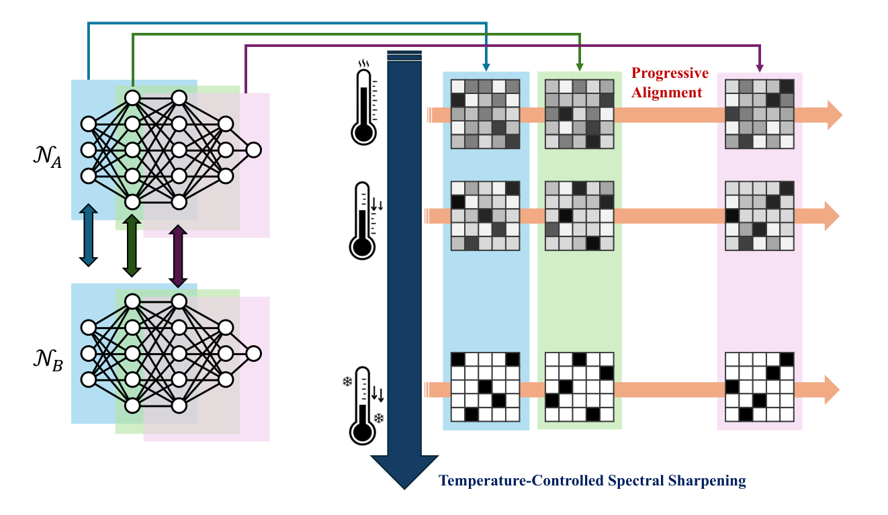

# Progressive Permutation Alignment with Temperature-Controlled Spectral Sharpening

**ACCV 2026** · Yuta Horioka\*, Naoya Chiba\*, Yuki Uranishi (The University of Osaka) · \*equal contribution

[Project page](https://yuzu0308.github.io/progressive-permutation-alignment/) ·
Paper (TODO) · Supplementary (TODO) · [Weights](https://huggingface.co/yuuxu/progressive-permutation-alignment)

<p align="center"></p>

Independently trained neural fields that represent the same scene differ by permutations of their hidden
units, so linearly interpolating their weights passes through a high loss barrier. This repository contains
the implementation of our alignment method and the code to reproduce every table of the paper and the
supplementary material.

The method visits the layers one by one. For each layer it computes the correlation matrix `C` with the
other layers' current (soft) permutations, takes its Hungarian solution `P̂` as an anchor, and updates the
layer to `P̂ [τ U Σ^τ Vᵀ + (1 − τ) I]` where `P̂ᵀC = U Σ Vᵀ`. The temperature is annealed over `τ ∈ {1, 0.5, 0}`,
after which a layer-wise weight-matching refinement starts from the result. There is no gradient descent.

## Installation

The alignment itself only needs PyTorch, NumPy and SciPy:

```bash
pip install -e .
```

Rendering-based evaluation (NeRF interpolation, activation matching, STE) needs nerfstudio. The paper
results were produced with Python 3.8, PyTorch 2.1.2 + CUDA 11.8 and nerfstudio 1.1.5:

```bash
conda create -n ppa python=3.8 -y && conda activate ppa
pip install torch==2.1.2 torchvision==0.16.2 --index-url https://download.pytorch.org/whl/cu118
pip install -e ".[nerf,cnn,dev]"
```

## Quick start

```python
from ppa import align, apply_permutation, interpolate
from ppa.nerf import filter_nerf_params, load_state_dict, vanilla_nerf_permutation_spec

a = load_state_dict("weights/lego/model_a.pth")   # nerfstudio vanilla-nerf state dicts
b = load_state_dict("weights/lego/model_b.pth")
spec = vanilla_nerf_permutation_spec()

result = align(spec, filter_nerf_params(a), filter_nerf_params(b), device="cuda")
b_aligned = apply_permutation(spec, b, result.perms)
midpoint = interpolate(a, b_aligned, 0.5)
```

For other architectures, describe which weight axes share a permutation with a `PermutationSpec`
(see `ppa/spec.py` and `ppa/zoo.py` for an MLP, VGG11 and ResNet18).

## Data and trained models

* NeRF Synthetic: download [`nerf_synthetic`](https://drive.google.com/drive/folders/128yBriW1IG_3NJ5Rp7APSTZsJqdJdfc1)
  and place the eight scenes under `data/nerf_synthetic/`.
* Trained models: the 16 vanilla NeRFs used in the paper (8 scenes × seeds 42/100, 1M iterations) are
  available on [Hugging Face](https://huggingface.co/yuuxu/progressive-permutation-alignment) (68 MB). `python scripts/download_weights.py` (needs
  `pip install huggingface_hub`) puts them under `weights/<scene>/model_{a,b}.pth`. The files
  `weights/<scene>/ref_perms_cpu.pt` hold the permutations produced by the original research code and are
  used by the regression test.
* To train them yourself:

  ```bash
  ns-train vanilla-nerf --machine.seed 42  --max-num-iterations 1000000 --data data/nerf_synthetic/lego blender-data
  ns-train vanilla-nerf --machine.seed 100 --max-num-iterations 1000000 --data data/nerf_synthetic/lego blender-data
  python scripts/export_weights.py --config outputs/lego/vanilla-nerf/<run>/config.yml --out weights/lego/model_a.pth
  ```

## Reproducing the paper

| Result | Command |
|---|---|
| Table 3, supp. Tables 1–3 (NeRF interpolation barrier) | `python scripts/reproduce_nerf.py --data-root data/nerf_synthetic --lambdas 0.5` then `python scripts/aggregate_lmc.py --methods naive wm prog-wm ours-no-ref ours` |
| Fig. 4 (metrics along λ) | `python scripts/reproduce_nerf.py --data-root data/nerf_synthetic --methods naive wm prog-wm ours-no-ref ours` then `aggregate_lmc.py ... --plot figs/` |
| Tables 1–2, supp. Tables 4–5 (shuffle recovery, time) | `python scripts/shuffle_recovery.py --models mlp5 resnet18 vgg11 nerf` |
| Single pair, any method | `python scripts/align_nerf.py --method ours --model-a ... --model-b ... --out ...` and `python scripts/eval_lmc.py ...` |

Method names: `ours`, `ours-no-ref`, the ablations `ours-no-svd[-no-ref]`, `ours-tau2[-no-ref]`,
`ours-tau5[-no-ref]`, and the baselines `naive`, `wm`, `prog-wm`, `ot4p-{0.3,0.5,0.7}`,
`prog-ot4p-{0.3,0.5,0.7}`, `am`, `ste`. Evaluating one method on all scenes at a single λ takes about
20 minutes on an RTX 5090, dominated by volume rendering.

## Results obtained with this code

NeRF interpolation barrier at λ = 0.5, mean over the 8 scenes of NeRF Synthetic (10 test views each), seeds
42 → 100, metrics on the float renders (RTX 5090). OT4P baselines with `--seed 0`.

| Method | RMSE ↓ | PSNR ↑ | SSIM ↑ |
|---|---:|---:|---:|
| Naive | 0.491 | 6.21 | 0.627 |
| Weight Matching | 0.294 | 11.07 | 0.653 |
| Progressive WM | 0.306 | 10.64 | 0.637 |
| OT4P (τ = 0.3 / 0.5 / 0.7) | 0.501 / 0.497 / 0.498 | 6.02 / 6.11 / 6.08 | 0.622 / 0.624 / 0.622 |
| Progressive OT4P (τ = 0.3 / 0.5 / 0.7) | 0.493 / 0.494 / 0.496 | 6.16 / 6.14 / 6.10 | 0.627 / 0.620 / 0.626 |
| Activation Matching (data-dependent) | 0.162 | 16.17 | 0.775 |
| STE | 0.268 | 11.84 | 0.663 |
| Ours w/o refinement | 0.199 | 14.22 | 0.697 |
| **Ours** | **0.199** | **14.40** | **0.710** |

Shuffle recovery (model B is a randomly permuted copy of model A): precision of the recovered permutation
in %, mean over 5 seeds (MLP5 and ResNet18, random initialisation) or 8 scenes (NeRF). WM, Progressive WM
and Ours recover every permutation exactly (L1 = 0) in all three settings.

| Method | MLP5 | ResNet18 | NeRF |
|---|---:|---:|---:|
| OT4P (τ = 0.3 / 0.5 / 0.7) | 100 / 100 / 100 | 99.90 / 99.92 / 99.88 | 7.51 / 99.16 / 99.19 |
| Progressive OT4P (τ = 0.3 / 0.5 / 0.7) | 34.67 / 51.76 / 66.78 | 32.60 / 45.73 / 52.94 | 1.39 / 3.66 / 6.39 |
| WM, Progressive WM, Ours | 100 | 100 | 100 |

## Notes on reproducibility

* The implementation reproduces the permutations of the code used for the paper bit-for-bit
  (`pytest tests/test_align.py`, needs the downloaded weights), and the rendered images of the proposed
  method and its ablations are pixel-identical to the ones behind the paper tables.
* Layer order: stage 1 visits the permutation groups in `sorted` order of their ids, which for the NeRF spec
  processes the colour-head groups before the trunk groups of each field. This is the order used for the
  paper; pass `order=` to `align` to change it.
* Correlations are normalised per layer (Frobenius norm) before summation, and each temperature runs up to
  100 sweeps until the alignment cost stops decreasing.
* As in OT4P, the last column of the anchor is sign-flipped when its determinant is negative, so at τ = 1
  the update equals `C` up to the sign of its last column.
* The OT4P baselines follow the official implementation line by line (eigendecomposition power, no anchoring
  to the identity, no exception handling) and are bit-identical to it; `variant="modified"` switches to the map
  of our method. They start from random parameters and the original scripts did not fix a seed; ours default
  to `--seed 0`, so their numbers differ slightly from the paper.
* On GPUs newer than the CUDA toolkit of the installed PyTorch (e.g. an RTX 5090 with the CUDA 11.8 wheels),
  PyTorch cannot JIT-compile the complex square root that OT4P's matrix power uses at τ = 0.5, and OT4P stops
  with an error there, as the official code does. Pass `--ot4p-power-device cpu` to compute that power on the CPU.
* Table 1 uses the ImageNet weights of torchvision for VGG11 / ResNet18
  (`python scripts/shuffle_recovery.py --pretrained --models vgg11 resnet18 --ot4p-power-device cpu`); the
  proposed method on ResNet18 is run with `--dtype float64`, because float32 cannot tell apart the near-zero
  filters of its first convolution. `python scripts/make_tables.py --no-timeout-marks` writes the LaTeX tables.
* Metrics: by default every method is evaluated the same way, on the float renders with torchmetrics' SSIM
  (Gaussian window). This reproduces all RMSE / PSNR values of the paper. A few table entries were computed
  differently in the paper; they can be obtained with the following options:

  ```bash
  # supp. Tables 2-3: SSIM of Naive / WM / Progressive WM (scikit-image SSIM on the saved PNGs)
  python scripts/aggregate_lmc.py --ssim skimage --methods naive wm prog-wm
  # supp. Table 3: "w/o Ref." rows of the two- and five-step schedules (averaged without lego)
  python scripts/aggregate_lmc.py --scenes chair ficus hotdog mic ship materials drums --methods ours-tau2-no-ref ours-tau5-no-ref
  ```

## Citation

```bibtex
@inproceedings{horioka2026progressive,
  title     = {Progressive Permutation Alignment with Temperature-Controlled Spectral Sharpening},
  author    = {Horioka, Yuta and Chiba, Naoya and Uranishi, Yuki},
  booktitle = {Proceedings of the Asian Conference on Computer Vision (ACCV)},
  year      = {2026}
}
```

## License and acknowledgements

MIT License. `ppa/spectral.py` and `ppa/baselines/ot4p.py` adapt code from
[OT4P](https://github.com/YamingGuo98/OT4P) (MIT), and `ppa/render.py` builds on
[nerfstudio](https://github.com/nerfstudio-project/nerfstudio) (Apache-2.0); see `THIRD_PARTY_NOTICES.md`.
Weight Matching follows [Git Re-Basin](https://github.com/samuela/git-re-basin).
This work was supported by JST PRESTO Grant Number JPMJPR25T6.
